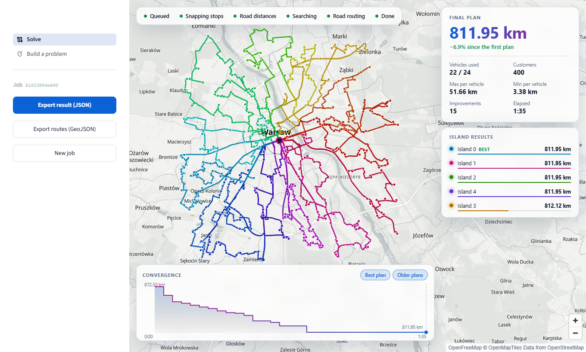
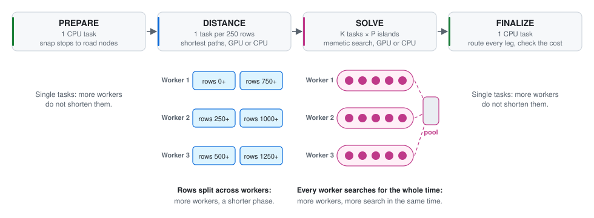
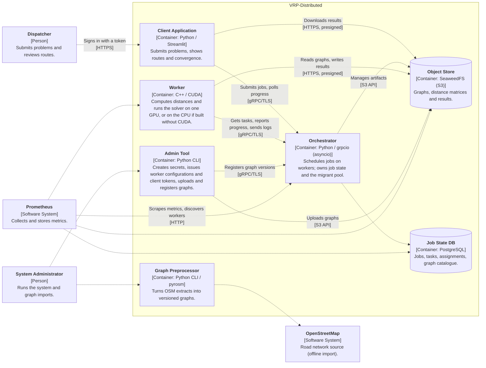

# vrp-distributed

A distributed GPU solver for the capacitated Vehicle Routing Problem on real
road networks: C++20/CUDA workers, which also build for machines without a
GPU, a Python asyncio orchestrator, PostgreSQL, an S3 object store, and a
Streamlit client that shows the search live on a map.

<picture>
  <source media="(prefers-color-scheme: dark)" srcset="docs/images/final-plan-dark.png">
  
</picture>

<sub>400 customers around Warsaw, solved in 60 s by 5 islands on one GPU. Map
data © OpenStreetMap contributors, tiles from OpenFreeMap and
OpenMapTiles.</sub>

## The problem

A depot, a fleet of identical vehicles with a capacity, and customers with
demands at real addresses. Find routes that start and end at the depot, serve
every customer once, never exceed a vehicle's capacity, and together drive
the shortest distance or time. The problem is NP-hard, so large instances
are solved with heuristics, and better routes come from searching more.

The costs are real road costs. Every stop is snapped to a road graph imported
from OpenStreetMap, the workers compute the full matrix of shortest paths
between stops, and the final routes are drawn along the roads.

## Where it is used

This capacitated VRP is the core of route planning for delivery fleets
(parcels, groceries, store replenishment), waste collection and field
service.

## How it scales

A job runs in four phases. Each worker holds the whole road graph, so any
worker can take any task ([ADR 0011](docs/adr/0011-work-split-across-gpus.md)).

<picture>
  <source media="(prefers-color-scheme: dark)" srcset="docs/images/pipeline-dark.svg">
  
</picture>

| Phase    | Work                                        | More workers                                        |
|----------|---------------------------------------------|-----------------------------------------------------|
| PREPARE  | Snap stops to road nodes, one CPU task      | No change                                           |
| DISTANCE | Shortest paths, 250 matrix rows per task    | Shorter: rows are split across workers              |
| SOLVE    | K tasks of P islands each, for a time limit | Same length, more search: better plans in that time |
| FINALIZE | Route every leg on the CPU, check the cost  | No change                                           |

Islands share their best plans through a pool in the orchestrator, so more
islands find better plans or reach a target sooner, with diminishing returns.
The design limits are 8 workers and 5,000 customers, with one job running at a
time. Multi-machine scaling has not been measured yet.

## Architecture

The container view of the [architecture model](docs/architecture/README.md).
Which machine runs what is in the
[deployment view](deploy/README.md#deployment), with the setup of a lab.

<!-- containers:start -->

<!-- containers:end -->

- **Orchestrator** (Python, asyncio, gRPC): owns all job state. One
  event-driven state machine makes every scheduling decision, and commits
  each to PostgreSQL before it sends a message
  ([ADR 0021](docs/adr/0021-orchestrator-scheduler-as-single-threaded-event-loop.md),
  [0022](docs/adr/0022-persist-state-transitions-before-sending.md)).
- **Workers** (C++20, CUDA): connect out to the orchestrator over one gRPC
  stream each, so the only port they open is for Prometheus, and run one
  task at a time on their GPU, or on every CPU thread when built without CUDA
  ([ADR 0002](docs/adr/0002-job-assignment-over-worker-initiated-streams.md),
  [0024](docs/adr/0024-worker-separates-session-and-compute-threads.md),
  [0037](docs/adr/0037-worker-without-cuda-runs-on-the-cpu.md)).
- **vrp-core**: the algorithms as a library with no networking: batched
  Bellman-Ford for distances, a hybrid genetic search whose local search runs
  on the GPU, CPU versions of both that give the same results, and leg
  routing ([how the solver works](docs/how-the-solver-works.md)).
- **Storage**: graphs, matrix rows and results go through SeaweedFS by
  presigned URLs, never through the orchestrator
  ([ADR 0007](docs/adr/0007-graph-distribution-object-store-with-local-cache.md),
  [0029](docs/adr/0029-object-store-seaweedfs.md)).

## Engineering properties

- **Commit before send.** A crash at any point leaves state that recovery
  understands. A Hypothesis property test generates random mixes of worker
  failures, lost connections and timeouts, and every job still ends
  (`test_every_job_ends`).
- **Exact, reproducible costs.** Costs are integers, so GPU distances are
  bit-identical to CPU Dijkstra, and FINALIZE re-routes every leg and must
  match the solver's cost exactly. On one machine, the same extract imports
  to the same bytes ([ADR 0020](docs/adr/0020-edge-cost-length-and-travel-time.md),
  [0027](docs/adr/0027-graph-file-format.md)).
- **Failure handling.** Leases with attempt numbers, reports kept until
  confirmed, solve progress saved every few seconds, and GPU workers that
  restart themselves after a lost GPU ([failure modes](docs/failure-modes.md)).
- **Short GPU steps.** Work is split into steps meant to stay well under a
  second, so that a Windows display driver does not reset the GPU, a cancel
  takes effect quickly, and a stuck task is detected
  ([ADR 0024](docs/adr/0024-worker-separates-session-and-compute-threads.md));
  the step length on the slowest GPU is still to be measured.
- **Security.** TLS on every connection with a lab CA made on first start,
  a named token with a role for every client and worker that can be revoked
  without a restart, URLs signed for one object, and no secret in the
  repository ([ADR 0009](docs/adr/0009-authentication-and-scoped-storage-access.md)).
- **CI.** Builds and tests on Windows and Linux, AddressSanitizer,
  UndefinedBehaviorSanitizer, ThreadSanitizer, Valgrind, clang-tidy and GCC
  warnings as errors, strict mypy, ruff, a dependency audit, the Compose stack
  started from scratch with a backup restored, and link and spelling checks.
  The CPU worker is built and tested in CI; the GPU tests run only on a
  machine with a GPU.
- **Decisions on record.** [Architecture decision records](docs/adr/README.md),
  each with its alternatives and how it is checked.

## Quick start

You need Docker 26 or newer, [uv](https://docs.astral.sh/uv/), and for the
worker an NVIDIA GPU with CUDA 12.8 or a later 12.x, or else any machine with
a C++20 compiler for the [CPU worker](worker/README.md#on-the-cpu).
[docs/setup.md](docs/setup.md) goes from a clean machine to a solved job.
Each release also has the control plane's images and the worker prebuilt for
Linux and Windows ([deploy/README.md](deploy/README.md)).

```sh
uv run --no-project deploy/demo.py
```

This starts the control plane, imports and registers a road graph of
Mazowieckie (Warsaw's region), and creates a worker configuration. Then build
and start the worker it names, open <https://localhost:8501>, sign in with
the token it prints, choose **Build a problem** and press
**Solve this problem**.

## Documentation

[docs/README.md](docs/README.md) maps every document: the setup guide, how the
solver works, the failure modes, the quality attributes, the formats and
protocol, the ADRs, and each component's README.

## Status and limits

Measured on two laptops on a 100 Mbps LAN, release builds: one with an
RTX 5050 Laptop GPU (8 GB) and an i7-14650HX, which also ran the control
plane, and a Linux one running the CPU worker on 12 threads:

| What                                        | Measured                                                                                                  |
|---------------------------------------------|-----------------------------------------------------------------------------------------------------------|
| Import of Mazowieckie, a 303 MB OSM extract | 629,318 nodes and 1,343,118 edges, `graph.bin` 23.7 MB; 82 s and 148 s in two runs, byte-identical output |
| Distance matrix, 5,000 customers            | 56 s on the GPU, 54 s on the 12-thread CPU, 30 s on both together                                         |
| FINALIZE, 5,000 customers                   | 1.8 s on the i7-14650HX, 7.2 s on the 12-thread CPU                                                       |
| 1,000 customers, 60 s, 5 seeds              | GPU and CPU together: median cost 0.32% below the GPU alone's                                             |
| 400 customers, 5 islands, 40 s limit        | 817.4 and 821.0 km in two runs, 22 of 24 vehicles used                                                    |

Not yet shown: more than two workers, the GTX 1060 that is the oldest target
GPU, and the worker installed as a systemd or WinSW service. The default of 5
islands per worker has not been benchmarked against fewer. The components'
READMEs list their known limits: [worker](worker/README.md) (graph parsing
and the stall check, log rotation, untested threads),
[client](client/README.md) (sign-in per tab, large road plans, untested map code)
and [orchestrator](orchestrator/README.md) (the memory check).
Certificates renew only by hand, once a year ([deploy](deploy/README.md#start-it)).

[docs/quality-attributes.md](docs/quality-attributes.md) lists every target
beside what has been measured.

## Attribution and license

Road data © [OpenStreetMap contributors](https://www.openstreetmap.org/copyright),
available under the Open Database License. The client's basemap comes from
[OpenFreeMap](https://openfreemap.org), with tiles from
[OpenMapTiles](https://openmaptiles.org). The solver follows HGS-CVRP by
Thibaut Vidal ([references](core/README.md#references)).

Licensed under the [Apache License 2.0](LICENSE).
