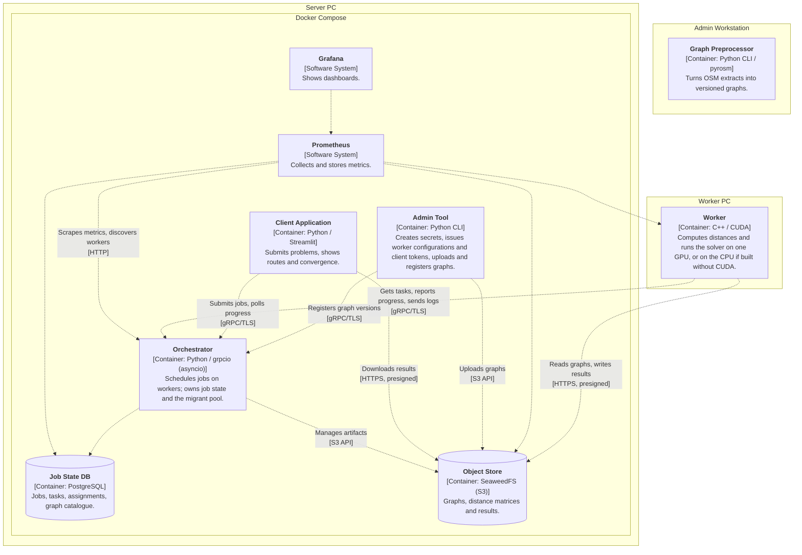

# Deployment

One Compose file runs the control plane (ADR 0031): PostgreSQL, SeaweedFS, the
orchestrator, Prometheus, Grafana, the client, a PostgreSQL metrics exporter
with a read-only role (ADR 0003) and the nightly backup. Workers run natively
on their own machines, with a GPU or the CPU build (ADR 0037). It needs Docker
26 or newer.

For a first run on one machine, `uv run --no-project deploy/demo.py` does the
steps below for you: it starts the stack, imports and registers a road graph,
and makes a worker configuration in `data/demo/` (`docs/setup.md`).

**From a release**, nothing needs building (ADR 0040). Each release on GitHub
has `vrp-deploy-<version>.tar.gz`, whose `compose.yaml` pulls that version's
images from GHCR in place of the build below, and a worker archive for Linux
and Windows, with CUDA or for the CPU, each with its service file.
`SHA256SUMS` checks the downloads. While the repository is private, log in
first with a GitHub token that can read packages:
`docker login ghcr.io -u <user>`. The commands below then run in the
bundle's folder, as `docker compose …` without `-f deploy/compose.yaml` or
`--build`, and `vrp-worker` comes from its archive.

The deployment view of the [architecture model](../docs/architecture/README.md):

<!-- deployment:start -->

<!-- deployment:end -->

## Start it

From the repository root:

```sh
docker compose -f deploy/compose.yaml up --build --wait
```

Then open:

| Address                  | What it is                                                     |
|--------------------------|----------------------------------------------------------------|
| <https://localhost:8501> | The client: sign in with a token ([below](#add-a-user)), solve |
| <http://localhost:3000>  | Grafana: log in as `admin`, password below                     |
| <http://localhost:9090>  | Prometheus                                                     |

```sh
docker compose -f deploy/compose.yaml run --rm admin grafana-password
```

The first start creates a private CA, TLS certificates, tokens and passwords
in the `secrets` volume, and each service sees only its own.

Certificates last a year. The `setup` service renews those within 30 days of
their end, but it runs only when the stack is brought up, and the services
read their certificates only when they start. So, once a year, renew them and
restart what uses them:

```sh
docker compose -f deploy/compose.yaml run --rm setup
docker compose -f deploy/compose.yaml restart orchestrator seaweedfs client
```

Workers reconnect within seconds and keep their tasks (`docs/failure-modes.md`).
When the CA itself was renewed, give each worker the new `ca.pem`.

## Open it to the lab

By default every port listens on this machine only. For workers and users on
other machines, give the name they reach this server by, or its IP address if it
is fixed, and its lab address:

```sh
VRP_HOST=server.lab VRP_BIND=192.168.1.10 docker compose -f deploy/compose.yaml up --build --wait
```

| Port  | Service      | Reachable from         |
|-------|--------------|------------------------|
| 50051 | Orchestrator | `VRP_BIND`             |
| 8334  | Object store | `VRP_BIND`             |
| 3000  | Grafana      | `VRP_BIND`             |
| 8501  | Client       | `VRP_BIND`             |
| 9090  | Prometheus   | This machine, no login |

Limit those four ports to the lab's subnet (ADR 0019), and each worker's
metrics port to the server. Docker's published ports bypass `ufw`, so on Linux
add the rule to Docker's own chain:

```sh
# On the server. Replace the subnet and the network interface.
sudo iptables -I DOCKER-USER -i eth0 -p tcp -m multiport --dports 50051,8334,3000,8501 ! -s 192.168.1.0/24 -j DROP
# On a Linux worker.
sudo ufw allow from 192.168.1.10 to any port 9101 proto tcp
```

```powershell
# On a Windows server.
New-NetFirewallRule -DisplayName "VRP server" -Direction Inbound -Protocol TCP -LocalPort 50051,8334,3000,8501 -RemoteAddress 192.168.1.0/24 -Action Allow
# On a Windows worker.
New-NetFirewallRule -DisplayName "VRP worker metrics" -Direction Inbound -Protocol TCP -LocalPort 9101 -RemoteAddress 192.168.1.10 -Action Allow
```

## Add a user

Each person who uses the client gets their own token, and signs in with it at
`https://<VRP_HOST>:8501` (ADR 0038). Jobs belong to the token's name.

```sh
docker compose -f deploy/compose.yaml run --rm -T admin client alice
```

The client serves HTTPS with a certificate from the lab's CA. To spare its
users the browser's warning, add the CA (`admin ca > ca.pem`, as for a
worker) to each machine's trusted roots; Firefox keeps its own list. The
client asks for the token again in each new tab and after a reload. To revoke
a user, delete their line from `tokens.txt`, as for a worker.

## Add a road graph

Import one with `vrp-preprocessor` (`preprocessor/README.md`), then register
its directory:

```sh
docker compose -f deploy/compose.yaml run --rm -v "$PWD/mazowieckie:/graph:ro" admin register-graph /graph
```

## Add a worker

Each worker gets its own token. In an empty folder for that worker:

```sh
docker compose -f deploy/compose.yaml run --rm -T admin worker lab-pc-1 --metrics-address lab-pc-1:9101 > worker.json
docker compose -f deploy/compose.yaml run --rm -T admin ca > ca.pem
vrp-worker --config worker.json
```

In PowerShell 5, `>` writes UTF-16, which the worker cannot read: use
`cmd /c "... > worker.json"`. For a worker on the server itself, use
`--metrics-address host.docker.internal:9101`. To revoke a worker, delete its
line from `tokens.txt` in the volume. The demo names its workers `demo-…`, and
makes a new one whenever the CA changes; the old line stays until deleted. A
machine without an NVIDIA GPU runs the
[CPU build](../worker/README.md#on-the-cpu) with the same configuration.

### Run it as a service

A worker exits after a stall, a lost GPU or out of memory, and relies on its
service manager to restart it (ADR 0024, 0032).

On Linux, with `vrp-worker`, `worker.json` and `ca.pem` in `/opt/vrp-worker`:

```sh
sudo useradd --system --home /opt/vrp-worker vrp
sudo chown -R vrp /opt/vrp-worker && sudo chmod 600 /opt/vrp-worker/worker.json
sudo cp deploy/worker/vrp-worker.service /etc/systemd/system/
sudo systemctl enable --now vrp-worker
```

On Windows, put these in one folder, such as `C:\vrp-worker`: `vrp-worker.exe`,
`worker.json`, `ca.pem`, `deploy\worker\vrp-worker-service.xml`, and
[WinSW v2.12.0](https://github.com/winsw/winsw/releases/tag/v2.12.0)'s
`WinSW-x64.exe` renamed to `vrp-worker-service.exe`. From an administrator's
prompt:

```bat
vrp-worker-service.exe install
vrp-worker-service.exe start
```

If CUDA finds no GPU from a service on a consumer card (ADR 0019), run the
worker as a logon task with restarts instead:

```powershell
$action = New-ScheduledTaskAction -Execute "C:\vrp-worker\vrp-worker.exe" -Argument '--config "C:\vrp-worker\worker.json"' -WorkingDirectory "C:\vrp-worker"
$settings = New-ScheduledTaskSettingsSet -RestartCount 999 -RestartInterval (New-TimeSpan -Minutes 1) -ExecutionTimeLimit 0
Register-ScheduledTask -TaskName "VRP worker" -Action $action -Trigger (New-ScheduledTaskTrigger -AtLogOn) -Settings $settings
```

## Backups

The `backup` service dumps the database every night at 02:00 UTC into
`deploy/backups`, keeping the last 14. Set `VRP_BACKUP_DIR` to a folder that
reaches the admin workstation, such as a mounted share, or copy from there.
A second Compose project from the same checkout would share the folder, so
give it its own `VRP_BACKUP_DIR`.

```sh
scp 'server.lab:vrp-distributed/deploy/backups/*.dump' backups/
```

Results and matrices are not backed up (ADR 0019). To back up now, check that
the latest dump restores, or restore one:

```sh
docker compose -f deploy/compose.yaml exec backup sh /backup.sh now
docker compose -f deploy/compose.yaml exec backup sh /backup.sh verify

docker compose -f deploy/compose.yaml stop orchestrator
docker compose -f deploy/compose.yaml exec backup sh /backup.sh restore vrp-20261124T020000Z.dump
docker compose -f deploy/compose.yaml start orchestrator
```

## Stop it

```sh
docker compose -f deploy/compose.yaml down     # keeps the data
docker compose -f deploy/compose.yaml down -v  # deletes the data and secrets
```

Deleting the secrets invalidates every worker's token and CA certificate.
