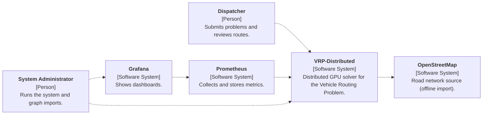
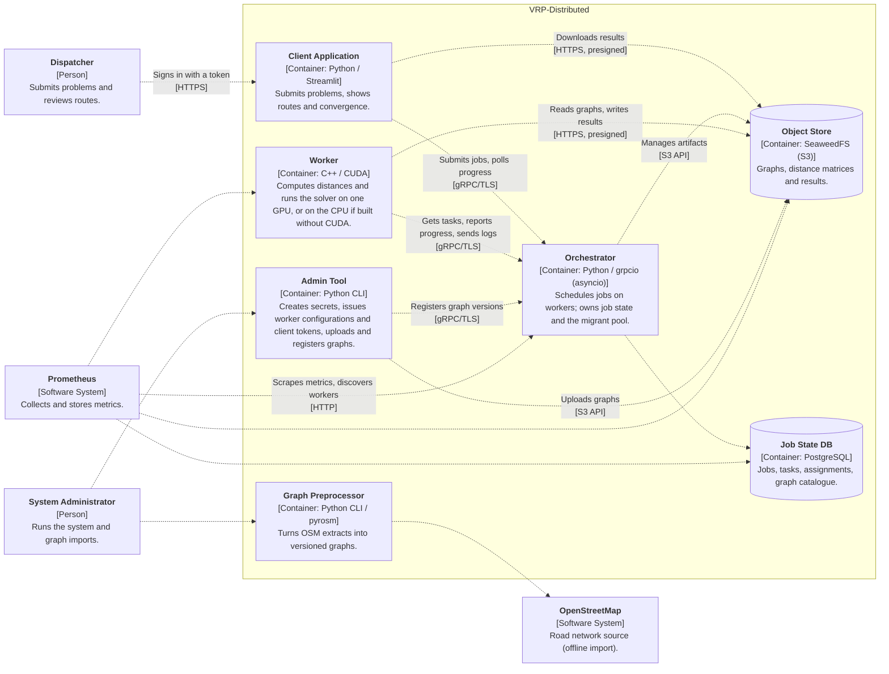
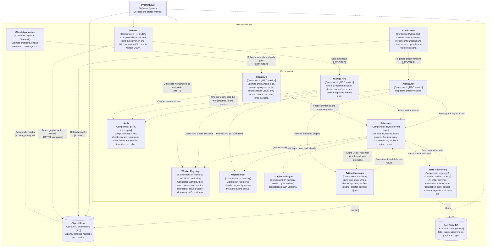
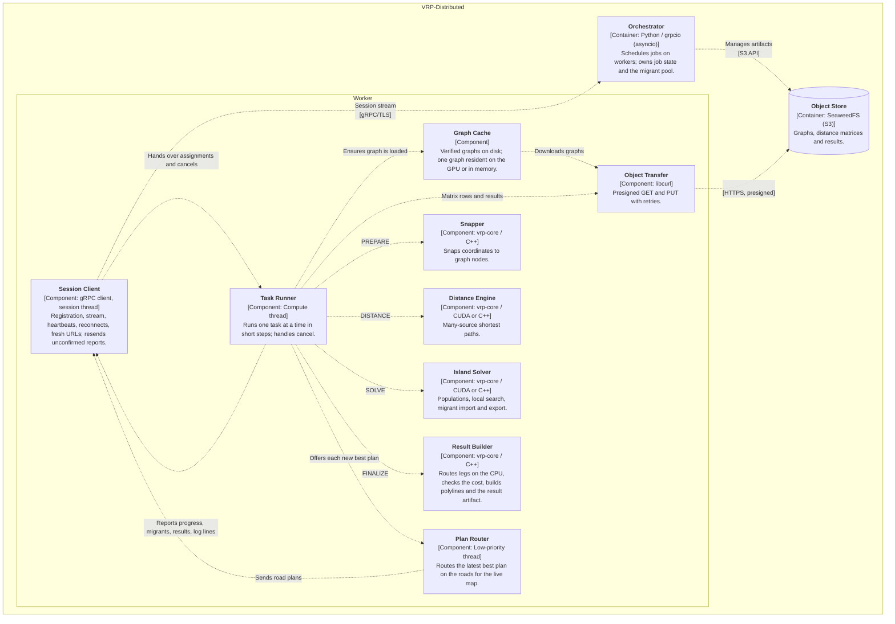
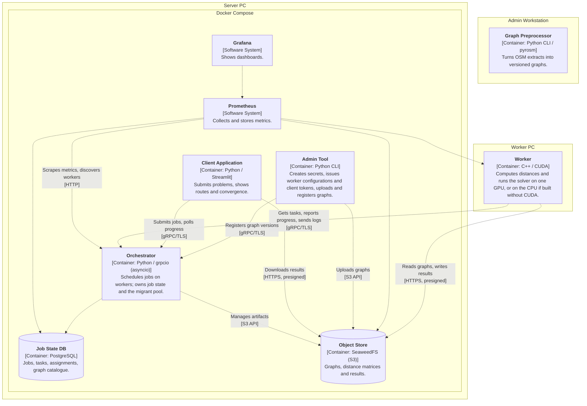

# Architecture views

Exported from [workspace.dsl](workspace.dsl) by `export.py`; do not edit by hand.

## System context

## Containers

## Orchestrator components

## Worker components

## Deployment in the lab

