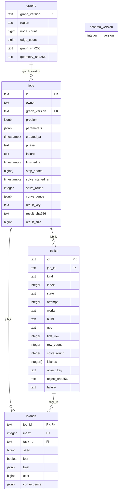

# Database schema

The orchestrator's PostgreSQL tables (ADR 0001); no other program reads or
writes them (ADR 0003). This page is generated from the migrated schema by
`python -m vrp_orchestrator.schema_doc`: change the migrations and their
`COMMENT ON` descriptions in `orchestrator/src/vrp_orchestrator/repository.py`,
then regenerate it.

## `graphs`

Registered graph versions (ADR 0015); jobs can use only these.

| Column            | Type   | Key | Null | Meaning                                                        |
|-------------------|--------|-----|------|----------------------------------------------------------------|
| `graph_version`   | text   | PK  |      | The graph version ID, such as mazowieckie-20261121-0469bc0a.   |
| `region`          | text   |     |      | The region slug.                                               |
| `node_count`      | bigint |     |      | Nodes of graph.bin.                                            |
| `edge_count`      | bigint |     |      | Edges of graph.bin.                                            |
| `graph_sha256`    | text   |     |      | SHA-256 of graph.bin, which workers check their cache against. |
| `geometry_sha256` | text   |     |      | SHA-256 of edge_geometry.bin; empty for an unsimplified graph. |

## `islands`

Islands of the solve phase and their best solutions (ADR 0014).

| Column        | Type    | Key    | Null | Meaning                                                              |
|---------------|---------|--------|------|----------------------------------------------------------------------|
| `job_id`      | text    | PK, FK |      | The job it belongs to.                                               |
| `index`       | integer | PK     |      | Its number, unique within the job.                                   |
| `task_id`     | text    | FK     |      | The solve task that runs it.                                         |
| `seed`        | bigint  |        |      | The seed of its random draws.                                        |
| `lost`        | boolean |        |      | Its task failed; its best solution still counts for FINALIZE.        |
| `best`        | jsonb   |        | yes  | Its best feasible solution, as vrp.v1.Solution JSON; null until one. |
| `cost`        | bigint  |        | yes  | The cost of that solution.                                           |
| `convergence` | jsonb   |        |      | Its best cost over time: [seconds since its task start, cost] pairs. |

## `jobs`

Submitted problems and their progress through the phases (ADR 0013).

| Column             | Type        | Key | Null | Meaning                                                               |
|--------------------|-------------|-----|------|-----------------------------------------------------------------------|
| `id`               | text        | PK  |      | The job ID.                                                           |
| `owner`            | text        |     |      | The token name of the client that submitted it (ADR 0009).            |
| `graph_version`    | text        | FK  |      | The graph version it runs on.                                         |
| `problem`          | jsonb       |     |      | The problem, as vrp.v1.Problem JSON.                                  |
| `parameters`       | jsonb       |     |      | Its solve parameters, as vrp.v1.SolveParameters JSON.                 |
| `created_at`       | timestamptz |     |      | When it was submitted; jobs run in this order.                        |
| `phase`            | text        |     |      | queued, prepare, distance, solve, finalize, done, failed, cancelled.  |
| `failure`          | text        |     |      | Why a failed job failed; else empty.                                  |
| `finished_at`      | timestamptz |     | yes  | When it ended; null while it runs.                                    |
| `stop_nodes`       | bigint[]    |     |      | The node each stop snapped to in PREPARE, the depot first.            |
| `solve_started_at` | timestamptz |     | yes  | When the solve group started; the time limit counts from here.        |
| `solve_round`      | integer     |     |      | Restarts of the solve phase after every island was lost (ADR 0014).   |
| `convergence`      | jsonb       |     |      | Its best cost over time: [seconds since the solve start, cost] pairs. |
| `result_key`       | text        |     |      | The object key of the result artifact (ADR 0016); empty until done.   |
| `result_sha256`    | text        |     |      | SHA-256 of the result artifact.                                       |
| `result_size`      | bigint      |     |      | Size of the result artifact, in bytes.                                |

## `schema_version`

The schema versions applied; the orchestrator refuses a newer one (ADR 0019).

| Column    | Type    | Key | Null | Meaning |
|-----------|---------|-----|------|---------|
| `version` | integer |     | yes  |         |

## `tasks`

Units of work, leased to one worker an attempt at a time (ADR 0013).

| Column          | Type      | Key | Null | Meaning                                                               |
|-----------------|-----------|-----|------|-----------------------------------------------------------------------|
| `id`            | text      | PK  |      | The task ID.                                                          |
| `job_id`        | text      | FK  |      | The job it belongs to.                                                |
| `kind`          | text      |     |      | prepare, distance, solve or finalize.                                 |
| `index`         | integer   |     |      | The chunk of a distance task, the place of a solve task in its group. |
| `state`         | text      |     |      | pending, leased, done or failed.                                      |
| `attempt`       | integer   |     |      | The latest attempt, 0 before the first; deadlines are kept in memory. |
| `worker`        | text      |     |      | The token name of the latest attempt's worker.                        |
| `build`         | text      |     |      | That worker's build.                                                  |
| `gpu`           | text      |     |      | That worker's GPU.                                                    |
| `first_row`     | integer   |     |      | The first matrix row of a distance task.                              |
| `row_count`     | integer   |     |      | The matrix rows of a distance task.                                   |
| `solve_round`   | integer   |     |      | The solve round of a solve task.                                      |
| `islands`       | integer[] |     |      | The islands a solve task runs.                                        |
| `object_key`    | text      |     |      | What the attempt that finished it uploaded: a matrix chunk or result. |
| `object_sha256` | text      |     |      | SHA-256 of that object, which readers of a matrix chunk check.        |
| `failure`       | text      |     |      | Why a failed solve task failed; else empty.                           |
