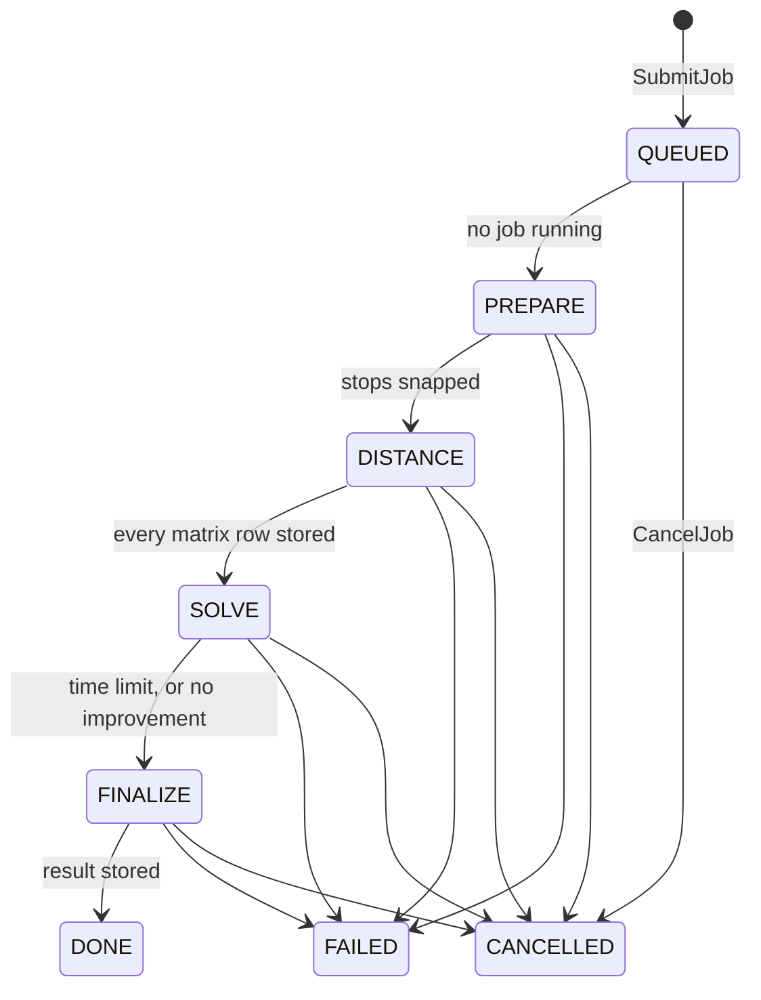
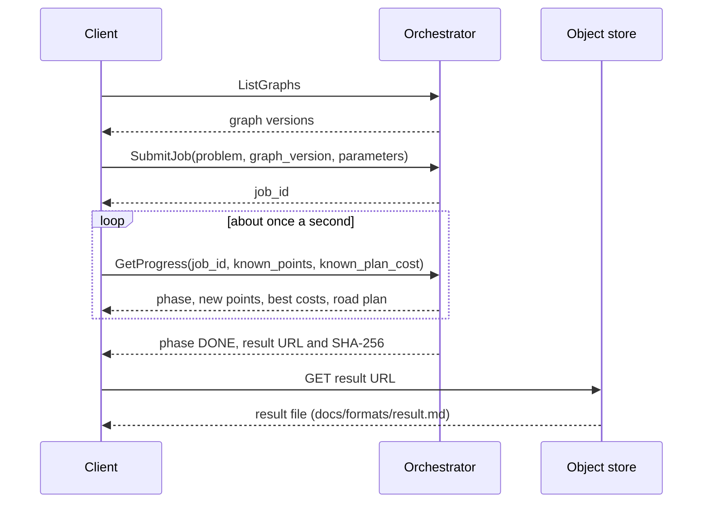
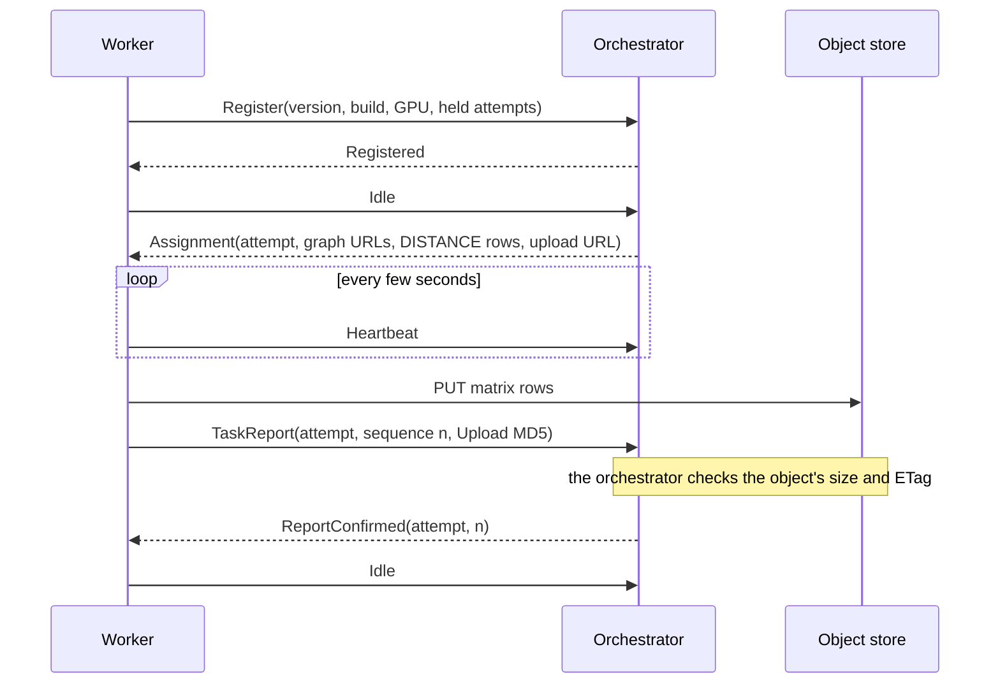
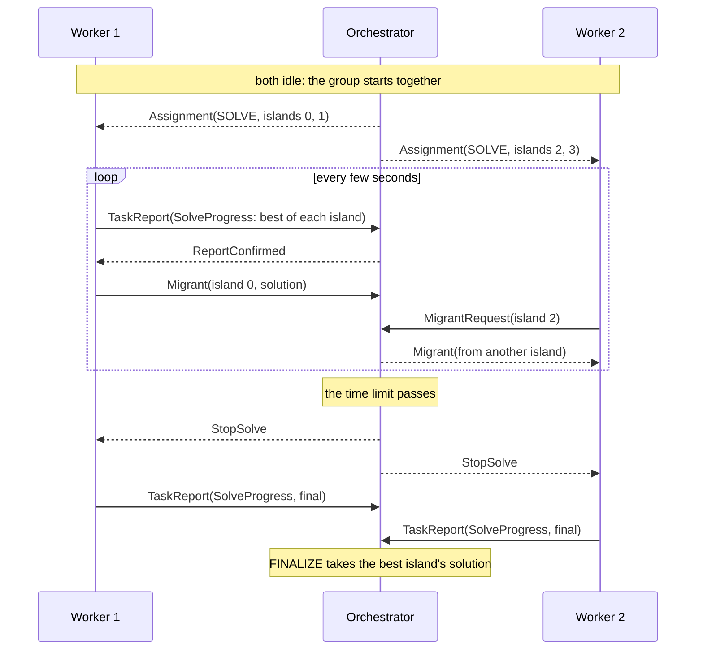

# Control-plane protocol, version 1.0

How the client, the workers and the administrator talk to the orchestrator
(ADR 0008). The contract is `proto/vrp/v1/vrp.proto`, whose comments define
each message and field; this page explains how the messages flow, and the
rules both sides follow. Persisted state is described in
`docs/formats/database.md`.

## Connections

All three services run on the orchestrator's one gRPC port, over TLS with
the lab CA's certificate (ADR 0009).

| Service         | Who calls it            | Role              |
|-----------------|-------------------------|-------------------|
| `ClientService` | The Streamlit client    | `client`, `admin` |
| `AdminService`  | The admin tool, scripts | `admin`           |
| `WorkerService` | Workers                 | `worker`          |

Every call carries its named token as `authorization: Bearer <token>`. A
call without a valid token ends with `UNAUTHENTICATED`, and one from a role
the service does not allow with `PERMISSION_DENIED`. A client sees, polls
and cancels only the jobs it submitted; an administrator, any job.

**Versions.** `ProtocolVersion` holds the version this file defines. A
worker sends its version in `Register`, and the orchestrator ends a session
of another major version. Within a major version, the contract only gains
fields and messages, so either side can be the newer one.

## Jobs

A job moves through its phases in order; at most one job runs at a time,
the others wait in the order they were submitted (ADR 0013).

A job fails with a reason, which polls show:

- `customers too far from every road: <stops>`: PREPARE could not snap these
  stop numbers within the snap distance, 0 being the depot (ADR 0006);
- `<kind> task <index> failed 3 times, last: <reason>`;
- `<kind> task <index>: <reason>`: a worker reported a failure that retrying
  cannot help, such as a stored matrix chunk that fails its SHA-256 (ADR 0014);
- `the problem needs more memory than any worker has`: 60 s into
  DISTANCE or SOLVE, no connected worker could fit that phase's tasks;
- `every solve task failed: <reason>`: no island has a solution because
  their tasks failed, as with a GPU out of memory;
- `no feasible solution found`: the islands ran, and none found one
  (ADR 0018); if some of their tasks failed, one failure follows it.

## Client calls

| Call          | Refused with                                           |
|---------------|--------------------------------------------------------|
| `ListGraphs`  | —                                                      |
| `SubmitJob`   | `INVALID_ARGUMENT`, `UNAVAILABLE`                      |
| `GetProgress` | `NOT_FOUND`, `PERMISSION_DENIED`, `RESOURCE_EXHAUSTED` |
| `CancelJob`   | `NOT_FOUND`, `PERMISSION_DENIED`                       |

- `INVALID_ARGUMENT`: an unknown graph version, a problem that cannot be
  feasible, bad parameters, or a problem with a phase that fits no
  connected worker.
- `UNAVAILABLE`: the database is down.
- `NOT_FOUND`: no such job. `PERMISSION_DENIED`: another client's job.
- `RESOURCE_EXHAUSTED`: a poll within 0.5 s of the client's last.

Cancelling a job that has ended does nothing.

A poll answers with the points from `known_points` on, so a client sends
how many it has. It also carries how many workers are connected, each
island's best cost, and the job's best plan on the roads if it beats
`known_plan_cost` (ADR 0030). The result URL is presigned and short-lived;
poll again for a fresh one. The client checks the downloaded file against
the SHA-256.

## Admin calls

The admin tool (`deploy/admin.py register-graph`) uploads a graph version's
files to `graphs/<version>/` (`docs/formats/graph.md`), then calls
`RegisterGraph`. The orchestrator
checks the files against their manifest first; only a registered version is
offered to jobs and workers (ADR 0015).

## Worker sessions

A worker opens one long-lived `Session` stream and keeps it open (ADR 0002).
Everything between the worker and the orchestrator goes over it.

**Sessions.** The first message is a `Register`. A new session from the
same worker, identified by its token name, replaces the old one. The worker
lists in `held` the attempts it still has; they keep their leases, and the
others fail at once (ADR 0014). It also gives its device: a GPU, or since
1.1 a CPU with its thread count, which the orchestrator uses to place tasks
and check their memory (ADR 0039).

**Attempts.** Every message about a task carries its `Attempt`: the task ID
and the attempt number. The orchestrator ignores a report for any attempt
other than the task's current one, or from another worker; a worker ignores
messages for attempts it does not run.

**Idle and leases.** A worker sends `Idle` when it has no task, and is then
given the next one. Assigning a task leases it to the worker for 30 s, and
every `Heartbeat` extends all of the worker's leases. A lease that runs out
fails its attempt.

**Reports.** Each report of an attempt has a higher `sequence` than the one
before. The worker keeps its latest report until a `ReportConfirmed` with
that sequence arrives, and sends it again after a reconnect (ADR 0022).
Reports are confirmed only once committed, an upload only once checked.

**Firm deadlines.** Two waits have a deadline that heartbeats do not
extend: an upload being checked, and a solve task told to stop, which has
30 s to send its final report. When the deadline passes, the attempt
fails, so a lost check or a missing final report cannot stall the job.

**Failures.** A `TaskFailure` ends the attempt. A PREPARE, DISTANCE or
FINALIZE task is then given out again, as the next attempt; after its third,
the job fails. A retry goes to a different connected worker if there is
one, and waits for it if it is busy. A SOLVE task is not given out again:
its islands are lost (ADR 0014). A failure marked `permanent` fails the job
at once, with its reason. The worker keeps a failure until the `Cancel` that
answers it and sends it again after a reconnect, so the orchestrator must
answer every failure it acts on with a `Cancel`: a failure lost otherwise
would leave a lease that heartbeats extend forever.

**Cancel** stops an attempt at once, and no report follows. The orchestrator
also sends it when it fails an attempt, and when a new session lists an
attempt the worker no longer holds, finished or lost; the worker then drops
the attempt and any report it keeps of it. **UrlRequest** asks for fresh
presigned URLs: the orchestrator sends the attempt's `Assignment` again, and
the worker takes only its URLs.

**Logs.** `LogBatch` carries JSON-line log records, which the orchestrator
writes into its own log (ADR 0010).

### Tasks

| Kind     | The assignment carries                           | The worker reports                             |
|----------|--------------------------------------------------|------------------------------------------------|
| PREPARE  | The problem, the snap distance                   | Each stop's node, or the stops too far         |
| DISTANCE | The stops' nodes, edge cost, rows, an upload URL | An `Upload` of the rows                        |
| SOLVE    | The problem, the matrix chunks, islands, seeds   | `SolveProgress`, a final one after `StopSolve` |
| FINALIZE | The best solution, its metadata, an upload URL   | An `Upload` of the result file                 |

Every assignment carries the graph files' URLs and SHA-256, which the
worker checks its cache against (ADR 0007).

### The solve phase

- **The group** starts when `task_count` workers are idle, or with fewer
  after 60 s; it does not change once started (ADR 0013).
- **Progress** reports only feasible solutions; a report holds each island's
  best and its new convergence points (ADR 0018).
- **Migrants** go through the orchestrator's pool every 2 s (ADR 0034),
  which keeps each island's latest one, and accepts it only from the attempt
  that runs the island. A `MigrantRequest` is answered, when another island has one, with
  a `Migrant` addressed to the island that asked. A receiving island checks
  a migrant before using it (ADR 0004).
- **Road plans.** A worker routes its latest best plan on the roads at low
  priority and sends it as a `RoadPlan`. Plans are for the live map: they are
  not persisted, confirmed or resent (ADR 0030).
- **Losing islands.** If every island is lost while time remains, the solve
  phase starts again once, seeded with the solutions saved so far
  (ADR 0014).

## Restarts and outages

- **A worker reconnects:** as under Sessions; it resends its unconfirmed
  report.
- **The orchestrator restarts:** it reloads its state, and every lease gets
  one more 30 s. Workers reconnect within it, listing their attempts.
- **The database is down:** heartbeats and polls are still answered, new
  jobs are refused with `UNAVAILABLE`, and nothing is assigned until it is
  back (ADR 0021).
- **The object store is down:** workers retry their transfers and keep their
  leases; a transfer still failing after 10 minutes fails its attempt
  (ADR 0014).

## Objects

Workers and clients reach the object store only through presigned URLs for
one object each (ADR 0009). Uploads are keyed by attempt, so a late upload
from a lost attempt never overwrites a good one (ADR 0014); when a task is
done, its failed attempts' objects are deleted (ADR 0016).

| Key                                       | Holds                                      |
|-------------------------------------------|--------------------------------------------|
| `graphs/<version>/graph.bin`              | The graph (`docs/formats/graph.md`)        |
| `graphs/<version>/edge_geometry.bin`      | Its edges' shapes, for a simplified graph  |
| `jobs/<job>/matrix/<chunk>-<attempt>.bin` | A DISTANCE task's rows                     |
| `jobs/<job>/result-<attempt>.json`        | The result file (`docs/formats/result.md`) |

A matrix chunk is `row_count` rows of the `(n + 1) × (n + 1)` matrix
(ADR 0011), row-major, each entry an unsigned 32-bit little-endian cost;
`4294967295` would mean no route, which ADR 0011 treats as a bug. The
reader checks each chunk against the SHA-256 in its `MatrixChunk`.
