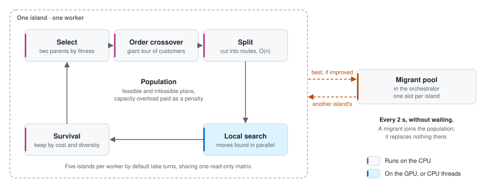
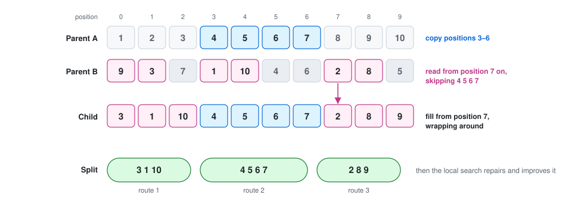

# How the solver works

For an engineer who has not met a VRP solver before. The decisions behind
each part are in ADR 0011, 0013, 0017, 0018, 0025 and 0034; the code is in
`core/src/solver/`, `core/src/gpu/` and `worker/src/task_runner.cpp`.

## The problem

A depot, customers with a demand each, and a fleet of identical vehicles
with a capacity. A plan is a set of routes, each leaving the depot, visiting
some customers and returning. Every customer is visited exactly once, no
route carries more than the capacity, and no more routes are used than there
are vehicles. The cost of a plan is the sum of its routes' road distances or
travel times; lower is better.

Customers are numbered from 1, and the depot is stop 0.

## From addresses to a cost matrix

The solver never looks at the map. It needs only the cost from every stop to
every other, which two phases compute:

- **PREPARE** snaps each stop to the nearest node of the road graph, on the
  CPU.
- **DISTANCE** computes shortest paths from every stop on the GPU: 32 sources
  at a time, one per lane of a warp, with a batched Bellman-Ford that relaxes
  edges until no cost improves (ADR 0017, 0033). Each task computes 250 rows
  of the matrix, so the rows of a large problem spread over every worker.

The result is an `(n + 1) × (n + 1)` matrix of whole metres or tenths of a
second. Roads are one-way at times, so the matrix is not symmetric.

## A giant tour and Split

A plan is hard to change directly: moving one customer can break a route's
capacity. So the search works on a **giant tour**, the order in which all
customers would be visited by one vehicle with no capacity, such as
`3 1 10 4 5 6 7 2 8 9`.

**Split** turns a giant tour into the best plan that keeps its order: it
chooses where to cut it into routes, so that the routes' total cost, plus a
penalty for any overload, is lowest. It does so in time linear in the number
of customers, within the fleet's vehicle count.

## One island

An island is one independent search, and each island solves the whole
problem. It follows HGS-CVRP, the hybrid genetic search of Thibaut Vidal
(see `core/README.md`), with its expensive part on the GPU.

<picture>
  <source media="(prefers-color-scheme: dark)" srcset="images/island-dark.svg">
  
</picture>

1. **Start.** The first 100 children are random giant tours.
2. **Select** two parents from the population. Each is the better of two
   random members by fitness, which ranks both cost and how different a
   member is from the others.
3. **Order crossover** makes a child tour from the two parents; see the
   example below.
4. **Split** cuts the child into routes.
5. **Local search** improves 8 children at once. On the GPU, one thread per
   customer finds that customer's best move among its 20 nearest customers:
   moving it, or it and its neighbour, elsewhere; swapping it with another;
   reversing part of a route; or exchanging the ends of two routes. On the
   CPU, the best moves that touch different routes are applied together, and
   the search repeats until no move improves.
6. **Survival.** Children join the population. When it grows too large, the
   members that are both costly and similar to others are removed.

Plans that overload a vehicle are allowed during the search, at a penalty per
unit of overload. The penalty adapts so that about a fifth of children are
feasible, and half of the infeasible children get a second local search with
ten times the penalty. Only feasible plans are reported or shared.

### Order crossover, worked through

The child keeps a random slice of the first parent in place, and takes the
remaining customers in the order the second parent visits them.

<picture>
  <source media="(prefers-color-scheme: dark)" srcset="images/crossover-dark.svg">
  
</picture>

- Parents: A = `1 2 3 4 5 6 7 8 9 10` and B = `9 3 7 1 10 4 6 2 8 5`.
  Positions count from 0.
- Copy A's positions 3 to 6 into the child: `4 5 6 7`.
- Read B from the position after the slice, wrapping around: `2 8 5 9 3 7 1
  10 4 6`. Skip the customers already in the child, which leaves
  `2 8 9 3 1 10`.
- Write those into the free positions, again from after the slice and
  wrapping around: the child is `3 1 10 4 5 6 7 2 8 9`.
- Split might cut it into `[3 1 10] [4 5 6 7] [2 8 9]`; the local search then
  repairs and improves the routes.

The slice is random, so most children are no better than their parents.
Selection keeps the ones that happened to inherit good parts.

## Many islands

A solve task runs P islands on its worker's GPU, 5 by default in the client.
They take turns on the GPU and share one read-only copy of the matrix. An
island lives on one worker for the whole task; it is never split or moved.

Islands search apart, so they explore different plans, and trade their best
ones through the **migrant pool** in the orchestrator (ADR 0004, 0034):

- Every 2 seconds, an island posts its best plan to the pool if it has
  improved, and asks for a copy of a random other island's.
- The pool keeps one slot per island, and nobody waits for an answer.
- A migrant joins the receiving island's population. It does not overwrite
  it, which would destroy the diversity that keeps the search moving.

## What more GPUs change

- **DISTANCE gets shorter**, because its rows are split across workers.
- **SOLVE takes as long**, since it runs until its time limit, or until the
  best cost stops improving. More workers run more islands in that time, so
  they find better plans, or reach a given cost sooner. Each extra island
  adds less than the one before.
- **PREPARE and FINALIZE** are single CPU tasks, and do not change.

## FINALIZE

The best plan is a list of stop numbers. FINALIZE checks it (every customer
once, no overload, no more routes than vehicles), routes every leg on the
road graph with a bidirectional Dijkstra on the CPU, and requires the legs to
add up to the solver's cost exactly. Costs are integers, so any difference is
a bug. It then writes the routes, as polylines along the roads, into the
result file (ADR 0025, `docs/formats/result.md`).
